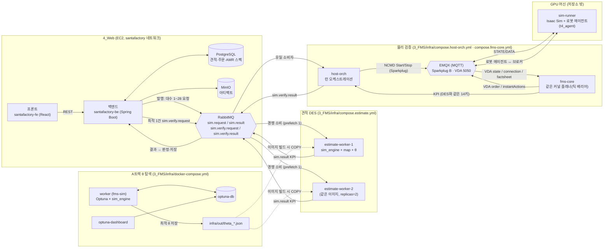
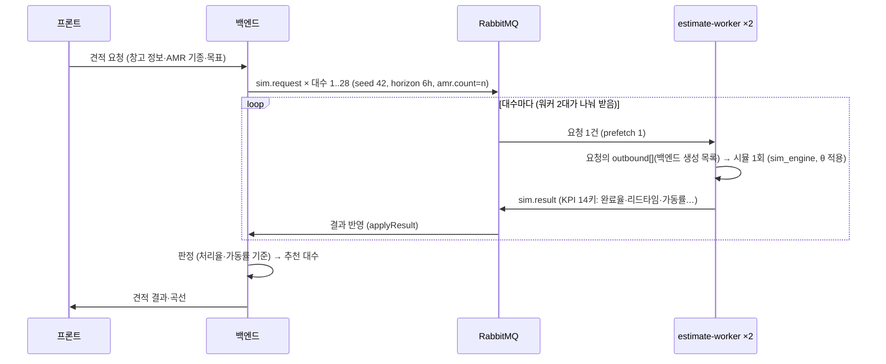
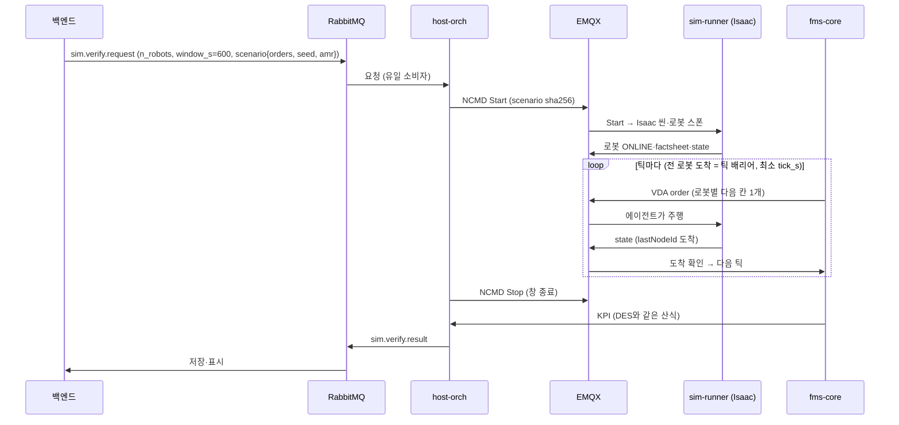

# 시스템 구성도 — 컨테이너·큐·브로커 (2026-09-11 기준)

저장소의 Dockerfile·compose·계약 문서에서 그대로 옮긴 그림이다. 새 결론은 없다.
근거: `3_FMS/infra/*.yml`, `4_Web/docker-compose.yml`, `contracts/SIM_VERIFY_CONTRACT.md`, `contracts/MQTT_CONTRACT.md`, `5_Docs/Web/시뮬엔진연동API명세서.md`.

## 1. 전체 그림

## 2. 견적 한 건의 흐름 (DES)

## 3. 물리 검증 한 건의 흐름

## 4. 브로커 두 개의 역할

| 브로커 | 프로토콜 | 큐·토픽 | 누가 |
|---|---|---|---|
| RabbitMQ | AMQP | `sim.request` → 워커, `sim.result` → 백엔드, `sim.verify.request` → host-orch, `sim.verify.result` → 백엔드 | 백엔드 ↔ 견적 워커 ↔ host-orch |
| EMQX | MQTT | Sparkplug B `spBv1.0/…`(host-orch ↔ sim-runner 제어·상태), VDA 5050 `uagv/v2/{mfr}/{serial}/order·state·…`(fms-core ↔ 로봇 에이전트) | host-orch, fms-core, Isaac 에이전트 |

RabbitMQ는 "일감 분배"(durable, ack 뒤 삭제, 경쟁 소비), EMQX는 "실시간 상태·명령"(retained·LWT·토픽 구독)이라 성격이 달라 둘을 쓴다.

## 5. 이미지와 그 안에 든 것

| 이미지 | 들어 있는 것 | 비고 |
|---|---|---|
| `fms-estimate-worker` | `sim_engine/` `map/` `contracts/` `infra/out/`(θ) `infra/worker/` | 주문은 백엔드가 생성해 요청에 싣는다(-197) — 이미지에 생성기 없음 |
| `fms-core` | 커널 + VDA 어댑터 | 견적 워커와 같은 커널 코드 → 패리티 테스트로 대조 |
| `fms-host-orch` | 오케스트레이션 | RabbitMQ·EMQX 두 네트워크에 붙음 |
| `fms-sim` | `sim_engine/` `ai_theta/` | A트랙 θ 탐색. `db-init`도 같은 이미지 |
| `santafactory-be` / `-fe` | 백엔드 / 프론트 | |
| 공개 이미지 | rabbitmq, postgres ×3, minio, emqx, optuna-dashboard, sonarqube, gitlab-runner | |

## 6. 지금 논의와 맞닿는 지점

- **주문 공유:** 주문은 견적 워커 안에서 만들어져 `sim.result`에 실리지 않는다. 물리 검증의 `scenario.orders`에 같은 주문을 넣으려면 워커가 결과에 주문을 실어 보내고 백엔드가 저장해야 한다(계획 B1·W1).
- **속도:** 견적 워커의 틱 길이(`--speed`)와 fms-core의 `--tick-s`·KPI 환산이 같은 값이어야 두 KPI가 비교된다(B2·P2).
- **격자·회전:** 견적 워커와 fms-core가 같은 커널·같은 `3_FMS/map` 1 m 격자를 쓴다. 회전 마스크를 커널에 넣으면 양쪽에 동시에 적용된다.
